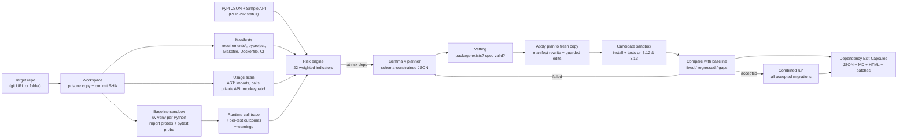

<div align="center">

# DoxOps

**Find dependencies that are about to break your project, plan the way out with Gemma 4, and prove the plan by running your tests.**


-4285F4)


</div>

DoxOps is an open-source developer tool for maintainers. Point it at a Python repository and it:

1. **Finds at-risk dependencies** from real signals: imports that crash, tests that fail, deprecation warnings, dead projects on PyPI, pins that drift between files, private-API use and more.
2. **Maps where and how each one is used**, statically (AST) and dynamically (a call trace recorded while the test suite runs).
3. **Asks Gemma 4 for a replacement and migration plan** with minimal code edits.
4. **Verifies the plan**: applies it to a throwaway copy, installs it in fresh virtualenvs, and runs the tests on Python 3.12 **and** 3.13 against the original baseline. Failed plans go back to Gemma with the categorised failure for repair.
5. **Writes a reusable Dependency Exit Capsule** per dependency (JSON + Markdown + HTML) in which every statement is labelled **OBSERVED**, **VERIFIED** (with the id of the logged, hashed command that proved it) or **AI**.

Built during Hacktoberfest Hack Day Mumbai × ISTE KJSSE (15 October 2026) for **Track 1: Gemma 4, Dependency Resilience**. The target repository is the organizer-provided [LinkWatch](https://github.com/rishrek/LinkWatch), which this repository forks.

---

## Contents

[Problem](#problem) · [Solution](#solution) · [Quick start](#quick-start) · [Usage](#usage) · [Architecture](#architecture) · [The capsule](#the-dependency-exit-capsule) · [AI model details](#ai-model-details) · [What it finds in LinkWatch](#what-doxops-finds-in-linkwatch) · [Tech stack and dependencies](#tech-stack-and-dependencies) · [Research behind the design](#research-behind-the-design) · [Known limitations](#known-limitations) · [Disclosure](#disclosure-pre-existing-work-and-ai-usage)

---

## Problem

Open-source projects quietly depend on packages that become unmaintained, deprecated, incompatible with new Python versions, or simply broken. Maintainers usually find out when something fails, then must work out **what** is affected, **where** it is used, **what** to replace it with and **whether** the replacement really works. AI assistants can suggest a replacement, but a suggestion is not evidence: LLMs pick wrong API versions, skip code and make unrequested edits ([Islam et al., 2025](#research-behind-the-design)).

## Solution

DoxOps connects AI-assisted analysis to repository inspection and execution:

| Challenge requirement | How DoxOps does it | Label in capsule |
|---|---|---|
| 1. Identify at-risk dependencies from repository and dependency metadata | 22 explainable indicators ([list](#risk-indicators)) from requirement files, `pyproject.toml`, Makefile/Dockerfile/CI, PyPI JSON + Simple API (PEP 792 status), import probes and the baseline test run | OBSERVED / VERIFIED |
| 2. Find where and how **all** of them are used | AST scan (imports, aliased calls, attribute chains, private API, monkeypatching), console-script references in build files, and a runtime call trace of the test suite | OBSERVED / VERIFIED |
| 3. Propose a replacement and migration for **all** of them | Gemma 4 returns a schema-constrained plan (strategy, package, version spec, steps, minimal edits, tests, expected gaps); DoxOps vets the package on PyPI to catch hallucinations | AI |
| 4. Execute tests on original and replacement | Fresh `uv` virtualenvs per attempt on every target Python, pytest with a probe plugin, per-test outcomes | VERIFIED |
| 5. Compare and list compatibility gaps and unresolved risks | Test-by-test diff (fixed / regressed / still failing), failure category explanations, deprecation-warning deltas, leftover-usage check, untested usage sites | VERIFIED |
| 6. Generate a reusable Dependency Exit Capsule | `capsule.json` (published JSON Schema), one Markdown + JSON capsule per dependency, an HTML report, `git apply`-able patches, and the migrated tree | all three, always separated |

## Quick start

Needs **git**, **[uv](https://docs.astral.sh/uv/)** and **[Ollama](https://ollama.com)** with a Gemma 4 model. Python 3.12 and 3.13 are fetched by uv.

### Windows (PowerShell)

```powershell
winget install --id astral-sh.uv -e
ollama pull gemma4:e4b
git clone https://github.com/avanishkasar/H26_DDoxers_DoxOps.git
Set-Location H26_DDoxers_DoxOps
.\scripts\demo.ps1 -Model gemma4:e4b          # every at-risk dependency; add -MaxDeps 4 for a short live demo
```

### macOS / Linux

```bash
curl -LsSf https://astral.sh/uv/install.sh | sh
ollama pull gemma4:e4b
git clone https://github.com/avanishkasar/H26_DDoxers_DoxOps.git && cd H26_DDoxers_DoxOps
scripts/demo.sh gemma4:e4b                   # every at-risk dependency; pass a 2nd arg (e.g. 4) to cap it
```

### Manual install

```powershell
uv python install 3.12 3.13
uv venv -p 3.12 doxops\.venv
$env:VIRTUAL_ENV = (Resolve-Path doxops\.venv).Path
uv pip install -e .\doxops
doxops\.venv\Scripts\doxops.exe doctor
```

Copy `.env.example` to `.env` to change the model, the Ollama host or to use the hosted Gemini API instead.

## Usage

| Command | What it does |
|---|---|
| `doxops doctor` | Checks git, uv, Python 3.12/3.13, Ollama and that the Gemma 4 model is pulled |
| `doxops scan [TARGET]` | No AI: manifests, usage, PyPI signals, baseline tests, risk ranking (about 15 s on LinkWatch) |
| `doxops run [TARGET]` | Full pipeline: scan, then plan + verify + repair each at-risk dependency with Gemma 4 |
| `doxops schema` | Prints the Dependency Exit Capsule JSON Schema (also in `doxops/schema/capsule.schema.json`) |
| `doxops render OUT_DIR` | Re-renders Markdown and HTML from an existing `capsule.json` |

`TARGET` is a git URL or a local folder and defaults to `https://github.com/rishrek/LinkWatch`.

Options for both `scan` and `run`:

| Option | Default | Purpose |
|---|---|---|
| `--python` | `3.12 --python 3.13` | Python versions to verify on (repeatable) |
| `--out DIR` | `doxops-out/<timestamp>` | Output folder |
| `--exclude DIR` | `doxops` | Top-level folders to ignore when scanning the target (repeatable) |
| `--ref REF` | default branch | Branch or tag to clone when `TARGET` is a URL |
| `--offline-index` | off | Use only cached PyPI metadata (no network lookups) |
| `--keep-envs` | off | Keep virtualenvs and attempt trees for inspection |
| `--fail-on LEVEL` | off | Exit code 3 if any dependency reaches `low`/`medium`/`high`/`critical` (CI gate) |

Options for `run` only:

| Option | Default | Purpose |
|---|---|---|
| `--provider` | `ollama` | `ollama` (local) or `gemini` (hosted Gemma 4 through the Gemini API) |
| `--model` | `gemma4:e4b` / `gemma-4-26b-a4b-it` | Model id |
| `--only DIST` | every at-risk dependency | Migrate only these dependencies (repeatable); the others still get a `not-attempted` capsule |
| `--max-deps N` | every at-risk dependency | Migrate the N highest-risk dependencies; the others still get a `not-attempted` capsule |
| `--max-repairs N` | `2` | Repair rounds after a failed verification |

`doxops run` checks that Ollama is reachable and the model is pulled before it starts, and stops with the fix if not.

Typical demo:

```powershell
doxops scan                                   # risk ranking only, no model needed
doxops run --out doxops-out/full             # plan + verify every at-risk dependency (Track 1 default)
doxops run --max-deps 4 --out doxops-out/demo # shorter live demo: the 4 highest-risk ones
start doxops-out/full/report.html
```

Run it on any other Python project, or on this fork itself (`doxops run .` ignores the `doxops/` folder by default).

### Output folder

```text
doxops-out/<run>/
├── report.html              # dashboard: KPIs, baseline, risk ranking, capsules, evidence log
├── REPORT.md                # same, as Markdown
├── capsule.json             # everything, machine-readable (RunSummary)
├── capsules/<dist>.md|json  # one Dependency Exit Capsule per dependency
├── patches/<dist>-attemptN.patch, combined.patch
├── migrated-repo/           # the target with every accepted migration applied
├── evidence/E001-*.log      # every executed command: command, cwd, exit code, output; SHA-256 in capsule.json
└── llm/NNN-*.prompt.md|response.txt   # every prompt and raw model reply
```

## Architecture



| Module (`doxops/src/doxops/`) | Responsibility |
|---|---|
| `manifests.py` | Parses requirement files (with `-r` includes and commented-out pins), `pyproject.toml` (dependencies, extras, groups, build-system), Python version hints; detects cross-file drift |
| `usage.py` | AST usage scanner and build-file tool-reference finder |
| `sandbox.py`, `probe/` | `uv` virtualenvs, `pip check`, import probes (normal and warnings-as-errors), pytest plugin that records outcomes, warnings, traceback frames and project→library calls |
| `pypi.py` | Async PyPI client with retries and cache: release history, yanks, classifiers, `requires_python`, PEP 792 project status, deprecation wording |
| `risk.py` | Deterministic, explainable scoring; failure attribution to the deepest declared library frame |
| `llm.py` | Ollama and Gemini API providers, JSON-schema-constrained output, validation with retry, full prompt/response logging |
| `planner.py` | Prompts, package vetting, manifest rewriting, guarded find/replace edits with indentation repair |
| `compare.py` | Test-by-test comparison and Breaking-Good-style failure explanations |
| `pipeline.py` | Orchestration, repair loop, residual-usage check, combined run, capsule assembly |
| `report.py`, `templates/` | Capsule Markdown, HTML report, JSON outputs |

### Guardrails that keep the AI honest

- **Schema-constrained output**: the plan's JSON Schema is passed to Ollama's `format`, then validated with Pydantic; invalid replies are retried with the validation error.
- **No whole-file rewrites**: edits are find/replace pairs that must match exactly once, so the model cannot silently drop code.
- **Manifests are ours**: the model chooses a strategy and version spec; DoxOps rewrites every declaration itself and validates the PEP 440 specifier.
- **Hallucination check**: the proposed package must exist on PyPI, not be quarantined/archived, and have a release matching the spec, before anything is installed.
- **Integrity guard**: tests and test-harness files (`conftest.py`, `pytest.ini`, `tox.ini`, `noxfile.py`) cannot be edited to make a runtime migration pass, and a test that passed before but is skipped afterwards counts as a regression.
- **AI stays labelled AI**: once a plan passes, only the executed choice (strategy, package, version spec) becomes VERIFIED; Gemma's analysis, rationale, steps and suggested tests keep the AI label.
- **Residual check**: after `replace`/`stdlib`/`remove`, any leftover import or build-file command of the old dependency rejects the attempt.
- **Acceptance rule**: install succeeds on every Python, zero regressions against the baseline, every edit applied, and the new package imports cleanly.

### Risk indicators

Each indicator adds its weight once (the score is capped at 100). A dependency is **at risk** at 20 points, or with any verified indicator of weight 25 or more.

| Code | Weight | Provenance | Signal |
|---|---|---|---|
| `IMPORT_FAILS` | 40 | VERIFIED | `import <module>` crashes in a fresh environment |
| `MISSING` | 40 | OBSERVED | Imported but provided by no declared dependency |
| `INDEX_STATUS` | 35 | OBSERVED | PyPI marks the project archived, deprecated or quarantined (PEP 792) |
| `TESTS_FAIL` | 30 | VERIFIED | Baseline tests fail with this library as the deepest declared frame |
| `YANKED_PIN` | 30 | OBSERVED | The pinned release was yanked |
| `NOT_ON_INDEX` | 30 | OBSERVED | The declared name does not exist on PyPI |
| `INACTIVE_CLASSIFIER` | 25 | OBSERVED | `Development Status :: 7 - Inactive` |
| `STALE_PROJECT` | 15 / 25 | OBSERVED | No release for 3 / 5+ years |
| `DEPRECATION_NOTICE` | 20 | OBSERVED | Project page says deprecated, unmaintained, superseded... |
| `PYTHON_UNSUPPORTED` | 20 | OBSERVED | Pinned release's `requires_python` excludes a target Python |
| `TOOL_BROKEN` | 20 | VERIFIED | Makefile/Dockerfile/CI call a command from a library that cannot import |
| `CONFLICT` | 20 | VERIFIED | `pip check` reports the installed set inconsistent |
| `UNDECLARED` | 20 | OBSERVED | Imported but only installed transitively |
| `UNUSED` | 20 | OBSERVED | Declared but never imported, called or invoked |
| `IMPORT_DEPRECATED` | 15 | VERIFIED | Import raises with deprecation warnings turned into errors |
| `OUTDATED_PIN` | 5 / 15 / 20 | OBSERVED | Exact pin behind latest / one major version behind / two or more |
| `MANIFEST_DRIFT` | 15 | OBSERVED | Declared with different constraints in different files |
| `PRIVATE_API` | 15 | OBSERVED | Uses `_private` names that can change without notice |
| `RUNTIME_DEPRECATION` | 10 | VERIFIED | Deprecation warnings attributed to it during the test run |
| `MONKEYPATCH` | 10 | OBSERVED | The project patches the library globally |
| `NO_TIMEOUT` | 10 | OBSERVED | `requests` calls (module-level or on a `Session`) without `timeout=`: they can hang, and a client with a default timeout changes behaviour |
| `PYTHON_CLASSIFIERS_OLD` | 5 | OBSERVED | Latest release advertises only older Python versions |

## The Dependency Exit Capsule

Each capsule contains every field the challenge lists, in this order:

1. Dependency details (declarations with file:line, pinned and latest versions with dates, PyPI status)
2. Risk indicators (weight, provenance, evidence ids)
3. Usage locations (static sites and runtime calls)
4. Proposed replacement (AI until verified, then VERIFIED with evidence ids)
5. Migration steps
6. Suggested tests
7. Executed test results (per Python: fixed, regressed, still failing, warning deltas; every attempt with its verdict and patch)
8. Compatibility gaps (verified regressions with failure category and explanation, plus gaps the model expects)
9. Open concerns and limitations (unapplied edits, vetting notes, usage sites never reached by the tests, low model confidence)

Capsule `status` is `verified`, `partially-verified` (accepted but tests that failed because of this dependency still fail), `unverified` (no attempt passed), `failed` (no usable plan) or `not-attempted` (scan only). The JSON Schema is in [`doxops/schema/capsule.schema.json`](doxops/schema/capsule.schema.json) so other tools can consume capsules.

## AI model details

| Field | Value |
|---|---|
| Model name | Gemma 4 (Google DeepMind open-weight model family) |
| Model version | Default `gemma4:e4b` (4.5B effective parameters) on Ollama; any Gemma 4 tag can be passed with `--model` (for example `gemma4:26b`), and the hosted default is `gemma-4-26b-a4b-it`. The exact tag, digest, quantisation and Ollama version used are recorded in every run's `capsule.json` (`model.details`). |
| Model source | Ollama library [`gemma4`](https://ollama.com/library/gemma4); hosted variant via the [Gemini API](https://ai.google.dev/gemma/docs/core/gemma_on_gemini_api) |
| Access method | Default: local inference through the Ollama REST API (`/api/chat`, JSON-schema `format`, temperature 0.2, thinking off). Optional: Gemini API `generateContent` with the key from `.env`. |
| License / terms | Gemma 4 is released with open weights under the Apache License 2.0 (as stated in the event handbook and on the model page). Hosted access is additionally subject to the Gemini API Terms of Service. |
| Role in the project | Gemma 4 analyses each at-risk dependency from DoxOps' observed and verified facts and the source that uses it, chooses a strategy (upgrade, replace, stdlib, remove, declare, keep) and a version spec, writes migration steps, minimal code edits, suggested tests and expected compatibility gaps, and repairs its plan when verification fails. It never decides whether something is at risk and never marks anything as verified: those come only from inspection and execution. |

No model is trained or fine-tuned. No data leaves the machine in the default (Ollama) configuration; PyPI metadata and packages are downloaded from the public index.

## What DoxOps finds in LinkWatch

`doxops scan` on [rishrek/LinkWatch@f52f393](https://github.com/rishrek/LinkWatch) (Python 3.12 and 3.13, baseline 9 passed / 1 failed on both) ranks:

| Dependency | Score | Key evidence |
|---|---|---|
| `jinja2` | 85 critical | VERIFIED `import jinja2` fails (`soft_unicode` removed from MarkupSafe); `test_report` fails; pinned 2.11.3 |
| `nose` | 85 critical | VERIFIED `import nose` fails (`imp` removed in 3.12); Makefile `nosetests` target broken; no release since 2015 |
| `pydantic` | 55 high | VERIFIED v1 emits a deprecation on Python 3.13 that becomes an error in 3.15; requirements pin v1 while pyproject asks for v2 |
| `setuptools` | 45 high | VERIFIED `pkg_resources` deprecation at import and during tests; `setuptools==75.8.0` is pinned as a runtime dependency |
| `requests` | 40 high | Private `requests.utils._parse_content_type_header`, a global monkeypatch of `Session.request`, and `session.get(url)` in `checker.py` with no timeout (so the `Timeout` handler can never fire) |
| `idna` | 35 medium | Pinned to 2018's 2.7 but never imported |
| `appdirs`, `toml` | 30 medium | No release for 6 years; Python classifiers stop at 3.8 and 3.9 |
| `certifi` | 20 medium | Imported in `checker.py` but never declared |
| `chardet` | 20 medium | Pinned two major versions behind; `charset-normalizer` is already installed through `requests`, which the plan prompt tells Gemma |
| `six` | 20 medium | Declared, never used (still pulled in by `python-dateutil`) |

These come from the tool's own run, not from a hand-written list: run `doxops scan` to reproduce them. The AI migration results depend on the model and hardware, so generate them with `doxops run` and read `REPORT.md`.

## Tech stack and dependencies

| Layer | Choice |
|---|---|
| Language | Python 3.12+ (uses `tomllib`, `sys.setprofile`, `StrEnum`) |
| CLI and terminal UI | `click` 8, `rich` |
| Data model and schema | `pydantic` 2 (every output is a typed model; JSON Schema exported) |
| HTTP | `httpx` (async PyPI client, Ollama and Gemini clients, timeouts and retries) |
| Versions and specifiers | `packaging` (PEP 440 / PEP 503 / PEP 508) |
| Reports | `jinja2` 3 (self-contained HTML, light and dark) |
| Sandboxing | `uv` (virtualenvs and installs), `pytest` in the target environment, `git` |
| Model runtime | Ollama with Gemma 4 (default) or the Gemini API |
| Quality | `pytest` unit tests, `ruff` lint and format, GitHub Actions on 3.12 and 3.13 |

Runtime dependencies are declared in [`doxops/pyproject.toml`](doxops/pyproject.toml). The probe scripts that run inside the target's environment use only the standard library.

### Reuse it elsewhere

- **CI gate**: `doxops scan --fail-on critical` exits with code 3 when a dependency is critically at risk.
- **Agent Skill**: [`skills/dependency-exit-capsule/SKILL.md`](skills/dependency-exit-capsule/SKILL.md) follows the [Agent Skills](https://agentskills.io/home) format so any compatible agent can drive DoxOps.
- **Capsule schema**: build dashboards or bots on `capsule.json`.

### Development

```powershell
cd doxops
uv venv -p 3.12 .venv; $env:VIRTUAL_ENV = (Resolve-Path .venv).Path
uv pip install -e ".[dev]"
.venv\Scripts\python -m pytest
.venv\Scripts\ruff check src tests
```

```bash
cd doxops && uv venv -p 3.12 .venv && uv pip install -e ".[dev]"
.venv/bin/python -m pytest && .venv/bin/ruff check src tests
```

`tests/test_e2e_scripted.py` runs the whole pipeline on the real LinkWatch repository with a scripted stand-in for Gemma (including a made-up package that must be rejected). It needs network access, so it only runs with `DOXOPS_E2E=1`.

## Research behind the design

| Source | Insight | Where it shows up |
|---|---|---|
| Islam, Jha, Mahmoud, Akhmetov, Nadi. *Using LLMs for Library Migration* (2025, [arXiv:2504.13272](https://arxiv.org/abs/2504.13272)) | LLMs get 89–94% of individual code changes right but only 26–57% of whole migrations; failures include argument transformations, unrequested edits, skipped code and using the wrong library version | Exact versions in the prompt, analysis-first schema, find/replace-only edits, behaviour-preservation rule, test-based acceptance |
| Islam, Jha, Mahmoud, Nadi. *MigrateLib: a tool for end-to-end Python library migration* ([arXiv:2510.08810](https://arxiv.org/abs/2510.08810)) | Baseline-first test validation; dynamic call graphs find usages that import scans miss; configuration and version mismatches need non-LLM handling | Baseline run before any change, runtime call trace, DoxOps-owned manifest rewriting |
| Reyes, Baudry, Monperrus. *Breaking-Good: Explaining Breaking Dependency Updates with Build Analysis* (SCAM 2024, [arXiv:2407.03880](https://arxiv.org/abs/2407.03880)) | Categorising the failure (removed API, version incompatibility, warnings-as-errors) makes breaks explainable | Failure classes and explanations in capsules; warnings-as-errors import probe |
| Reyes et al. *BUMP: A Benchmark of Reproducible Breaking Dependency Updates* ([arXiv:2401.09906](https://arxiv.org/abs/2401.09906)) | Breaking updates must be reproduced, not assumed | Every claim of breakage is backed by an executed, logged command |
| Miller, Jahanshahi, Mockus, Vasilescu, Kästner. *Understanding the Response to Open Source Dependency Abandonment in the npm Ecosystem* (ICSE 2025) | Abandonment is common; projects act much faster when end-of-life is stated explicitly | Explicit end-of-life signals (PEP 792 status, inactive classifier, deprecation wording) weigh more than release age; the capsule itself is a low-effort transparency mechanism |
| [PEP 792](https://peps.python.org/pep-0792/) project status markers | PyPI can mark projects archived, deprecated or quarantined | Read from the Simple API and used both for risk and for vetting proposals |

## Known limitations

- Usage discovery combines static analysis with a runtime trace; dynamic imports (`importlib`, plugins loaded through entry points) can still be missed.
- Verification is only as strong as the target's tests. DoxOps reports usage sites the tests never reach instead of claiming them verified.
- Gemma 4 output varies between runs and model sizes; smaller models produce more rejected attempts. Every attempt, accepted or not, is kept with its prompt, reply, patch and verdict.
- Migrations are verified one at a time and then together; interactions between two accepted plans that touch the same lines are reported in `patches/combined-conflicts.txt`, not resolved automatically.
- Only Python projects with requirement files or `pyproject.toml` and a pytest-compatible suite are supported.
- PyPI-derived signals (age, classifiers, wording) are heuristics. Package metadata and installs need network access to PyPI.
- Two libraries doing the same job (for example `chardet` next to `charset-normalizer`) are not scored as redundant by themselves; DoxOps gives Gemma the list of packages already installed through other dependencies so a plan can prefer one of them.
- `NO_TIMEOUT` only knows `requests`; other HTTP clients without a default timeout are not checked.
- Security vulnerabilities are out of scope for this challenge and are not scored.

## Disclosure: pre-existing work and AI usage

- **Pre-existing code**: everything outside `doxops/`, `skills/`, `scripts/`, `.github/`, `.env.example`, the added `.gitignore` lines and this README is the organizer-provided LinkWatch starter (MIT), kept unchanged so DoxOps can be run against it. Its original README is in [`LINKWATCH.md`](LINKWATCH.md).
- **Written during the event**: the DoxOps package, tests, CI, Agent Skill, demo scripts and documentation.
- **Third-party software**: click, rich, httpx, pydantic, packaging, jinja2, pytest, ruff, uv, Ollama and Gemma 4, each under its own license.
- **AI usage**: Gemma 4 is the runtime model inside DoxOps as described above. AI coding assistants were also used during development for drafting and review; the team reviewed, ran and tested the code.

## Team DDoxers

Built at Hacktoberfest Hack Day Mumbai × ISTE KJSSE, 15 October 2026.

## License

DoxOps is released under the [MIT License](doxops/LICENSE). The LinkWatch starter keeps its own [MIT License](LICENSE).
